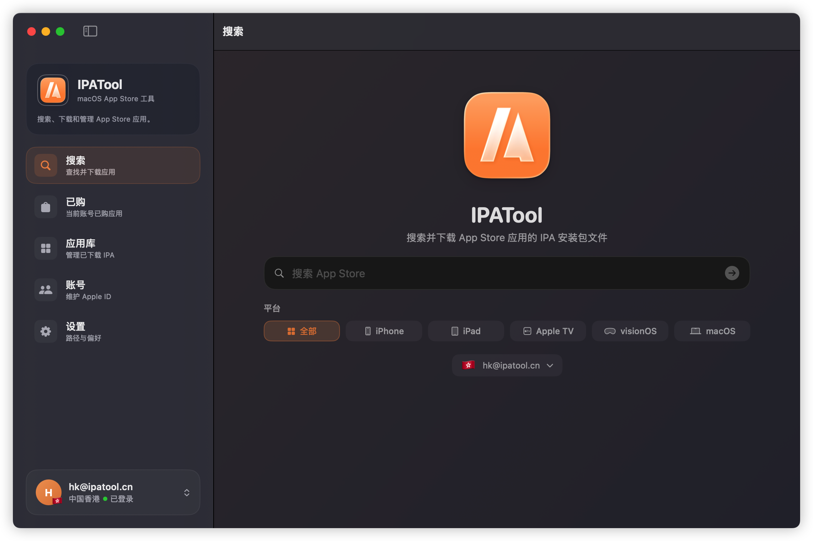

# IPATool

[](LICENSE)


**言語：** [English](README.md) · [简体中文](README.zh-Hans.md) · [繁體中文](README.zh-Hant.md) · [日本語](README.ja.md) · [한국어](README.ko.md)

IPATool は、App Store のアプリを検索し、ライセンスを取得して IPA パッケージをローカルにダウンロードするためのネイティブ macOS デスクトップアプリです。複数地域の Apple ID 管理、二要素認証、購入済みアプリの閲覧、過去バージョンのダウンロード、iOS / iPadOS / tvOS / visionOS / macOS の全プラットフォームに対応しています。



## ダウンロード

- [App Store](https://apps.apple.com/cn/app/ipatool/id6774012874)
- [GitHub Releases](https://github.com/maclub-net/ipatool/releases)

## ウェブサイト

https://www.ipatool.cn

## 機能

- **アプリ検索**：キーワードで App Store を検索。iPhone、iPad、Apple TV、visionOS、macOS のプラットフォームフィルターに対応。入力後に自動で検索します。
- **複数アカウント管理**：異なる地域の Apple ID を複数追加し、ワンクリックで切り替え。アカウント情報は macOS Keychain に暗号化して保存されます。
- **二要素認証**：2FA が必要な場合、専用の 6 桁コード入力画面が表示され、全桁入力後に自動送信されます。
- **トークン自動更新**：パスワードはアカウントと共に暗号化して保存され、認証情報が失効した際に自動で再ログインしてトークンを更新します。2FA が必要な場合は再ログインが必要なアカウントとしてマークされます。
- **購入済みアプリ**：現在のアカウントの購入済みアプリ一覧を閲覧。プラットフォームでフィルタリングし、アプリをクリックすると詳細が表示されます。
- **アプリ詳細**：アプリアイコン、開発者、価格、説明、スクリーンショット、ダウンロード可能な過去バージョンの一覧を表示します。
- **ダウンロード管理**：非同期のダウンロードキュー、リアルタイム進捗。一時停止、キャンセル、削除、Finder で表示に対応。
- **macOS パッケージ復号**：macOS アプリはダウンロード後に StoreAgent エンジンで自動復号され、インストール可能な `.ipa` パッケージとして出力されます。
- **ファイル命名**：ダウンロードファイルは `アプリ名_バージョン(バージョンID代替)_アカウント.ipa` の形式で命名されます。

## 動作環境

- macOS 14.0 (Sonoma) 以降
- Xcode 15 以降（ソースからビルドする場合）

## ソースからビルド

```bash
git clone https://github.com/maclub-net/ipatool.git
cd ipatool
xcodebuild -project IPATool.xcodeproj -scheme IPATool -configuration Release build
```

ビルドされたアプリは `DerivedData/IPATool/Build/Products/Release/IPATool.app` に生成されます。

## プロジェクト構成

```
Sources/
├── CSAP/          # C 層 SAP/StoreAgent エンジン（署名、macOS パッケージ復号）
├── IPAToolCore/   # コアロジック：App Store API クライアント、SAP 署名器
├── IPAToolGUI/    # SwiftUI インターフェースとアプリ状態管理
└── IPAToolCLI/    # コマンドラインエントリー
```

## コミュニティ

- [QQ グループ](https://qm.qq.com/q/VPxUSjKUma)
- [QQ チャンネル](https://pd.qq.com/s/foo260n5q)
- [GitHub Issues](https://github.com/maclub-net/ipatool/issues)

## クレジット

プロトコルおよび復号ロジックは [ipatool](https://github.com/majd/ipatool) を参考にしています。

## ライセンス

本プロジェクトはカスタムライセンスの下で提供されています。**個人の学習、教育、非商用目的での使用は無料です。** **商用利用には商用ライセンスの取得が必要です。**

詳細な条件は [LICENSE](LICENSE) をご覧ください。

商用ライセンスの申請は https://www.ipatool.cn または dustink@qq.com までお問い合わせください。
